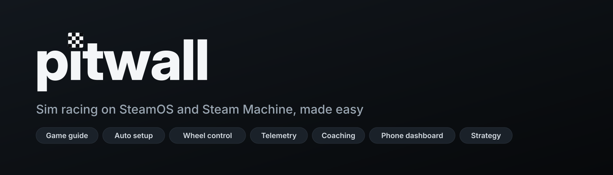
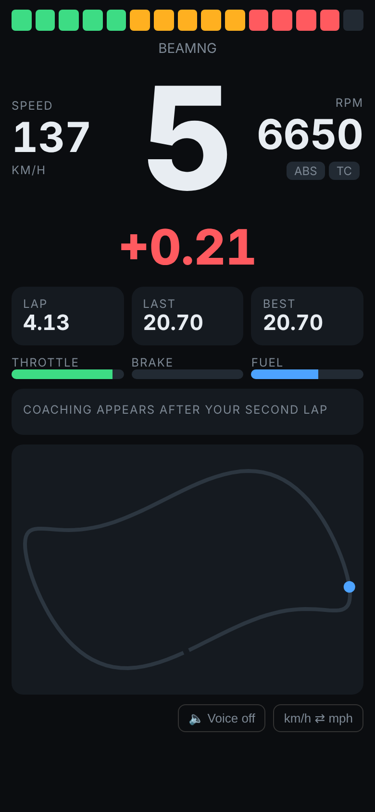
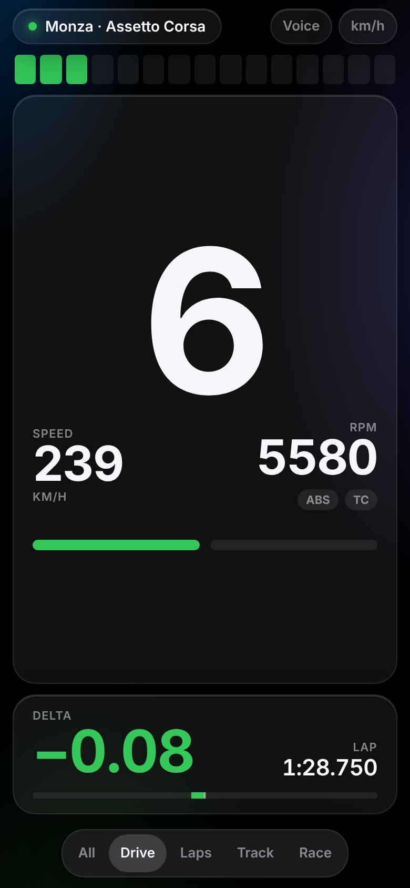
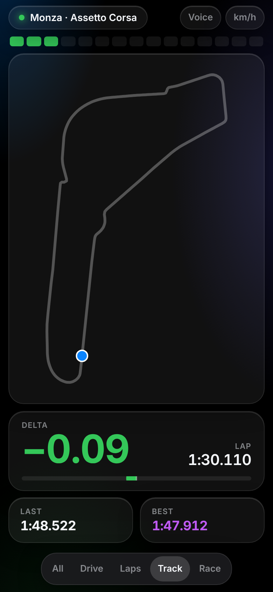

<p align="center">
  
</p>

<p align="center">
  <a href="../../actions/workflows/build.yml"></a>
  
  
  
  
</p>

**Pitwall makes sim racing on Linux easy.** It's a [Decky Loader](https://decky.xyz) plugin for the Steam Machine, Steam Deck and other SteamOS PCs, and also runs on its own without Decky. It helps you set up your sims and wheel, then helps you drive faster: from the Quick Access Menu in Gaming Mode, or from a web app in Desktop Mode.

> **0.1.0 preview.** Pitwall is feature-complete for its first release but **hasn't been tested on real hardware yet**. Reports are very welcome: [open an issue](../../issues/new/choose).

## What it does

### Get set up
| Feature | What it does |
|---|---|
| **Auto setup** | Recognises your device and wheel and applies the best starting settings in one tap |
| **Game guide** | For each sim: whether it runs on SteamOS, how to install it, in-game force feedback settings and known issues, with live ratings from Valve, ProtonDB and Are We Anti-Cheat Yet |
| **One-tap telemetry** | Switches on each sim's data output for you where possible, and installs the bridge that Proton games need, without touching your other launch options |
| **Force feedback setup** | Shows whether your wheel has force feedback and which effects its driver supports, tests it with a gentle pull, and on SteamOS builds and installs the community driver your wheel needs (MOZA on older kernels, Logitech, Fanatec, Thrustmaster, Simagic), with a reinstall prompt after SteamOS updates |
| **Pre-race checks** | Confirms the wheel, force feedback driver, telemetry and game compatibility before you drive |

### Drive
| Feature | What it does |
|---|---|
| **Wheel control** | Rotation, force feedback strength and effects for MOZA, Logitech, Fanatec and Thrustmaster, saved per game and per car and applied automatically |
| **Force feedback tuning** | Sourced starting presets, then describe what feels wrong and get a small, explained change you can undo |
| **Rev lights** | Lights the RPM LEDs on supported MOZA and Logitech wheels from the game's live data |

### Go faster
| Feature | What it does |
|---|---|
| **Live telemetry** | Reads speed, inputs, laps, fuel and tyres from more than 20 sims |
| **Phone dashboard** | Scan a QR code to turn any phone on your Wi-Fi into a dash: shift lights, gear, live delta, lap times, fuel, tyres, track map and voice callouts, with five layouts from everything to just the essentials |
| **Coaching** | Compares each lap with your best, corner by corner: where you braked, how fast you went through, and how much time it cost |
| **Strategy** | Fuel per lap, laps remaining and how much to add at a stop; tyre temperatures, balance and wear |

### Keep it smooth
| Feature | What it does |
|---|---|
| **Performance check** | Measures frame-rate consistency during real driving and tells you what to change for your screen's refresh rate |
| **Lightweight** | Sleeps when no game is sending data, and reads game data in place rather than copying it |

### Get help
| Feature | What it does |
|---|---|
| **Engineer debrief** | A summary of your session and the corners that cost the most time, optionally written up by Claude with your own API key |
| **Updates** | Checks daily whether the drivers and telemetry bridge Pitwall installed have newer versions, and updates them with one tap |
| **Send diagnostics** | Bundles everything needed for a bug report, ready to download to your phone and attach to a pre-filled GitHub issue |

## The phone dashboard

Scan the QR code in Pitwall and any phone on your Wi-Fi becomes a dash. Below are three of its five layouts during a GT3 session at Monza (demo data, as Pitwall hasn't been tested on real hardware yet). Swipe or tap the bar at the bottom to switch layouts; each works in portrait and landscape.

<table>
  <tr>
    <td align="center"></td>
    <td align="center"></td>
    <td align="center"></td>
  </tr>
  <tr>
    <td align="center"><b>All</b><br><sub>Everything at once: revs, gear, delta, times, fuel, tyres, coaching and the map</sub></td>
    <td align="center"><b>Drive</b><br><sub>Just what you glance at while driving: revs, gear, speed and delta</sub></td>
    <td align="center"><b>Track</b><br><sub>A big map drawn from your own laps, with where you are now</sub></td>
  </tr>
</table>

The other two layouts are **Laps** (a big delta and lap time with coaching) and **Race** (fuel and tyres first, for longer races). More in [Getting started](docs/getting-started.md#4-open-the-phone-dashboard).

## Quick start

Pitwall comes two ways. Pick one; both have every feature.

| | **Decky plugin** | **Standalone** |
|---|---|---|
| Best for | Gaming Mode, controller-friendly | Desktop Mode, or if you don't use Decky |
| Interface | Quick Access Menu plus a full-screen page | Web app on the same machine |
| Needs | [Decky Loader](https://decky.xyz) | A password for your user (to install) |

**Decky plugin**

1. Install [Decky Loader](https://decky.xyz).
2. Download the latest build: **Actions → build → newest run → Artifacts → Pitwall** (signed in to GitHub), and extract GitHub's outer zip to get `Pitwall-0.1.0.zip`. A Releases page will follow once 0.1 has been tested.
3. Decky → cog → **Developer mode** on → **Install Plugin from ZIP File**.
4. Open Pitwall and press **Run auto setup**.

**Standalone**

1. Download **Artifacts → Pitwall-standalone** from the same build and extract `Pitwall-standalone-0.1.0.tar.gz`.
2. In a terminal in the extracted folder: `./install.sh`
3. Open **Pitwall** from your app menu (or http://127.0.0.1:8091) and run auto setup.

See **[docs/standalone.md](docs/standalone.md)** for how it differs (mainly: launch option changes are applied when Steam is closed).

New Steam Machine? Follow the **[day-one guide](docs/day-one.md)** from unboxing to first lap.

## No plugin? Use the website

The **[Pitwall website](https://crspytopgn.github.io/pitwall/)** works in any browser: check whether a sim runs on SteamOS and whether your wheel works on Linux, look up recommended wheel settings, calculate fuel, and follow the day-one checklist.

## Which sims work?

| Sim | Runs on SteamOS | Pitwall telemetry |
|---|---|---|
| BeamNG.drive | Yes, native | Yes |
| Euro Truck Simulator 2, American Truck Simulator | Yes, native | Experimental (SDK plugin) |
| DiRT Rally 2.0, DiRT Rally | Yes | Yes |
| DiRT 4 | With setup | Yes |
| Forza Horizon 4 / 5 | Yes | Yes |
| Forza Horizon 6 | Yes | Untested (Data Out not yet confirmed) |
| Forza Motorsport | Community fixes only | Yes |
| F1 23 | Yes | Experimental |
| F1 22, F1 2021 | With setup | Experimental |
| Live for Speed | Yes | Basic (no lap timing) |
| Assetto Corsa, ACC | With setup | Yes, via one-tap bridge |
| AC EVO | With setup | Partial, via one-tap bridge |
| AMS2, Project CARS 2, rFactor 2, AC Rally | With setup | Experimental, via one-tap bridge |
| Le Mans Ultimate | Community fixes only | Experimental, via one-tap bridge |
| RaceRoom | With setup | Experimental (manual bridge) |
| iRacing | Offline Test Drive only | No |
| EA SPORTS WRC, F1 24, F1 25 | No (anti-cheat) | No |

The full, sourced guide is in **[docs/compatibility.md](docs/compatibility.md)** (generated from the same data the app uses).

## Documentation

[Day one](docs/day-one.md) · [Install](docs/install.md) · [Getting started](docs/getting-started.md) · [Compatibility](docs/compatibility.md) · [Telemetry](docs/telemetry.md) · [Wheels](docs/wheels.md) · [Wheel support table](docs/wheel-support.md) · [Toolbox](docs/toolbox.md) · [FFB tuning](docs/ffb-tuning.md) · [Strategy](docs/strategy.md) · [Performance](docs/performance.md) · [Coaching](docs/coaching.md) · [Troubleshooting](docs/troubleshooting.md) · [FAQ](docs/faq.md)

## How it's built

- **No third-party Python dependencies**: everything uses the standard library, so it runs on Decky's bundled Python.
- **Light on the Steam Machine**: idle, it checks for telemetry every two seconds; shared memory is read in place without copying.
- **Verified protocols**: MOZA commands are checked byte for byte against Boxflat; shared-memory readers are checked against fixtures written by C code using the real struct definitions.
- **Sourced knowledge**: every known issue and preset links its source, and the test suite enforces it.

```
main.py                     Decky backend entry point
src/index.tsx               Quick Access Menu and full-screen UI
py_modules/pitwall/
  telemetry/                UDP parsers (OutGauge, MotionSim, Forza, Codemasters, F1) and shared-memory readers
  laps.py, coach.py         lap detection, live delta, braking-zone coaching
  hub.py, store.py          live state, SQLite lap history
  dashboard.py, web/        phone dashboard (HTTP + Server-Sent Events)
  wheels/                   MOZA serial driver; Logitech, Fanatec, Thrustmaster sysfs drivers
  drivers.py, ffbtest.py    force feedback driver installer for SteamOS, FFB test effect
standalone/                 runs the same backend without Decky: service, local web app, Steam integration, installer
  leds.py, ffb.py           rev lights, FFB presets and feel tuner
  strategy.py               fuel and tyre strategy
  diagnostics.py            bug-report bundle and pre-filled issue
  compat.py, data/          game guide, live ratings, auto setup
  bridge.py                 winecarte download and launch options
  health.py, perf.py        pre-race checks (wheel identification), MangoHud analysis
  device.py                 device detection and auto setup
  data/                     games.json, wheels.json, tools.json: the sourced knowledge base
  engineer.py               debrief (offline, optional Claude)
site/                       the GitHub Pages website (built from the same data)
tools/                      C programs that generate shared-memory offsets and test fixtures
```

See [CONTRIBUTING.md](CONTRIBUTING.md) to build, test or add a sim or wheel.

## Support the project

Pitwall is free and open source. If it saved you an evening of setup, you can [sponsor its development](https://github.com/sponsors/crspytopgn) or [buy me a coffee](https://buymeacoffee.com/crspytopgn). The most valuable help right now is testing on real hardware and [reporting what works](../../issues/new/choose).

More from me: [OpenMCM2](https://github.com/crspytopgn/openmcm2) · [OpenSGolf](https://github.com/crspytopgn/opensgolf) · [OpenLinks2003](https://github.com/crspytopgn/openlinks2003).

## Credits

Pitwall builds on the work of the Linux sim racing community. The main ones:

- MOZA protocol: [Boxflat](https://github.com/Lawstorant/boxflat) by Tomasz Pakuła
- Shared-memory layouts: [simapi](https://github.com/Spacefreak18/simapi) and [simshmbridge](https://github.com/Spacefreak18/simshmbridge) by Spacefreak18
- Telemetry bridges: [winecarte](https://github.com/srounce/winecarte) by srounce, [Datalink](https://github.com/LukasLichten/Datalink) by Lukas Lichten
- Wheel drivers: [new-lg4ff](https://github.com/berarma/new-lg4ff) by berarma, [hid-fanatecff](https://github.com/gotzl/hid-fanatecff) by gotzl, [hid-tmff2](https://github.com/Kimplul/hid-tmff2) by Kimplul, [universal-pidff](https://github.com/JacKeTUs/universal-pidff) by JacKeTUs
- Wheel support table: [linux-steering-wheels](https://github.com/JacKeTUs/linux-steering-wheels); toolbox list: [awesome-linux-simracing](https://github.com/LukasLichten/awesome-linux-simracing) (CC BY-SA 4.0)
- Compatibility data: [ProtonDB](https://www.protondb.com), Valve's Steam Deck ratings, [Are We Anti-Cheat Yet](https://areweanticheatyet.com), [GamingOnLinux](https://www.gamingonlinux.com)
- Built on [Decky Loader](https://github.com/SteamDeckHomebrew/decky-loader) by Steam Deck Homebrew

Full list with licences, including bundled libraries, icons and fonts: [CREDITS.md](CREDITS.md).

Pitwall is unofficial and not affiliated with Valve, MOZA Racing or any sim developer. Licensed under GPL-3.0.

<sub>Keywords: sim racing Linux, F1 23 Linux telemetry, Euro Truck Simulator 2 wheel Linux, SteamOS sim racing, Steam Machine racing wheel, Steam Deck racing wheel, MOZA Linux, MOZA R3 SteamOS, Boxflat Decky, BeamNG telemetry Linux, Assetto Corsa Proton telemetry, ACC Linux telemetry, SimHub on Linux, racing dashboard phone, Decky plugin racing.</sub>
